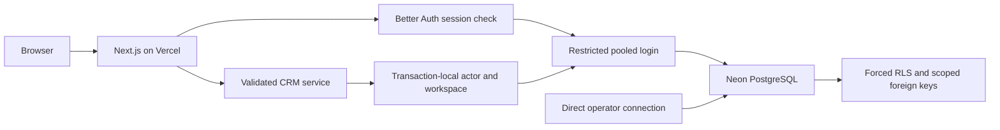

# Architecture
Browser → Next.js marketing/server-rendered app shell → authenticated route handlers/server actions → validation → session + workspace membership → transaction-local RLS context → service/repository → PostgreSQL. All mutations and reads server-side authorized. Auth tables managed by selected library and inaccessible from client. Use separate runtime and migrator roles; public provisioning via narrowly scoped audited mechanism. No direct DB from browser, no secrets in NEXT_PUBLIC.

Modules: auth/session, workspace/membership, leads, contacts, companies, deals/pipeline, tasks, activities, reporting, search, import/export, sandbox, quotas/audit, optional AI. Keep business service pure where possible; route handlers are thin. API errors typed, status mapped and sanitized; correlation IDs not customer content. Avoid circular dependencies. Shared schemas and DTOs in domain modules. Server components use same authorized service layer; never use privileged shortcuts. Use server cache only for public static content or properly scoped safe keys; no cross-tenant caching; private responses no-store.

Database request flow: authenticate library session, resolve membership through narrowly scoped auth/workspace bootstrap, begin transaction on one pooled client; SET LOCAL via parameterized set_config(...,true) for user/workspace; RLS policies restrict tenant + app membership checks; execute service, audit activity and commit; rollback on errors, release. Avoid context surviving transaction pooling. RLS setup and any SECURITY DEFINER bootstrap function use fixed search_path, minimal execute grants, no dynamic SQL; tenant role non-owner and NOBYPASSRLS, no DDL. Verify owner/migrator role not present in runtime. Document auth tables' separate access model and how membership bootstrap avoids circular RLS. Test no-context denial and pooled cross-request leakage.

Workflow: lead conversion and deal stage mutation atomically update records and activity, optimistic version check; UI rolls back failed requests and refetches. Analytics queries computed over same workspace and date/currency contract; no stale cross-user cache. Import preview is nonmutating; confirmation bounded atomic transaction (idempotency token, checksum, reject changed payload). Export filtered/scoped, capped, CSV sanitized. Global search indexed and limited. Quota counters persistent, sandbox expiration enforced server-side every request.

Deployment: Vercel Node functions, Neon pooled runtime, direct migration connection used in local/CI authorized step only. No background worker dependency. Avoid long transactions/network calls inside transaction. Optional external AI separate endpoint with fixed synthetic input; provider timeout and quota handling. No external API called by core workflow.

## Deployed request path

The runtime may call narrowly scoped database functions for quota counters, account invitation acceptance, and expired-guest cleanup. The application acquires a workspace-scoped advisory lock for writes and uses read-only repeatable-read transactions for reports and other tenant reads.
