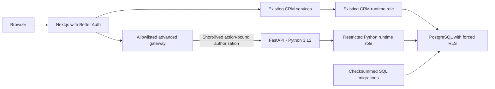

# Clorix 2.0 engineering track

The production release remains on the verified Clorix 1.0 commit while the upgrade is exercised on an isolated database. Upgrade work is tracked on the `clorix-2.0` branch.

## Service boundaries

The gateway resolves membership using the authenticated browser session before requesting the Python service. It releases its database transaction before the network call. The signed grant contains that resolved actor and workspace, action scope, exact request target and HTTP method, SHA-256 payload digest, request ID, and a maximum 45-second lifetime. FastAPI rechecks scope, membership, expiration, and PostgreSQL policies. The shared signing key belongs to the two servers.

Psycopg uses a small connection pool with transaction-local actor and tenant settings. Prepared statements are disabled to support Neon transaction pooling. The Python role has explicit grants and no access to Better Auth session tables, role escalation, schema creation, or arbitrary tenant bootstrap. SQL in `db/migrations` remains authoritative. Python writes use the same workspace advisory lock as existing CRM mutations.

## Local verification

Install Node 24 and Python 3.12. Install both locked dependency sets with `npm ci` and `uv sync --locked --project backend`. Use the existing isolated `clorix_test` database. Run `npm run db:migrate` then `npm run db:admin -- grant`.

On the existing Windows test environment, `node --env-file=.env.local scripts/configure-engine-test.mjs` generates the restricted local role and ignored engine configuration. Run the FastAPI test suite and the live cross-language test with `node --env-file=.env.local --env-file=artifacts/private/engine.env scripts/test-engine.mjs`. CI provisions independent fixture-only logins. Run `uv run --project backend ruff check backend` for Python lint.

The Python health endpoint is `GET /health`. The authenticated tenant path is exercised by the real gateway test. `CLORIX_ENGINE_URL` and `CLORIX_ENGINE_SIGNING_KEY` belong to the upgraded Next.js server, and the Python server additionally requires `CLORIX_ENGINE_DATABASE_URL`. Configure production after an isolated candidate verifies the relevant release scope.
