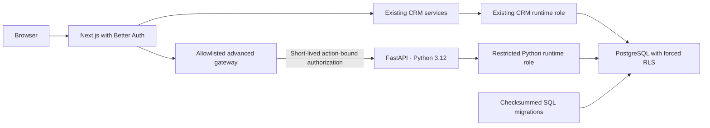

# Clorix 2.0 engineering track

The production release remains on the verified Clorix 1.0 commit while the upgrade is exercised on an isolated database. Upgrade work is tracked on the `clorix-2.0` branch.

## Service boundaries

The gateway resolves membership using the authenticated browser session before requesting the Python service. It releases its database transaction before the network call. The signed grant contains that resolved actor and workspace, action scope, exact request target and HTTP method, SHA-256 payload digest, request ID, and a maximum 45-second lifetime. FastAPI rechecks scope, membership, expiration, and PostgreSQL policies. The shared signing key belongs to the two servers.

Psycopg uses a small connection pool with transaction-local actor and tenant settings. Prepared statements are disabled to support Neon transaction pooling. The Python role has explicit grants and no access to Better Auth session tables, role escalation, schema creation, or arbitrary tenant bootstrap. SQL in `db/migrations` remains authoritative. Python writes use the same workspace advisory lock as existing CRM mutations.

## Local verification

Install Node 24 and Python 3.12. Install both locked dependency sets with `npm ci` and `uv sync --locked --project backend`. Use the existing isolated `clorix_test` database. Run `npm run db:migrate` then `npm run db:admin -- grant`.

On the existing Windows test environment, `node --env-file=.env.local scripts/configure-engine-test.mjs` generates the restricted local role and ignored engine configuration. Run the FastAPI test suite and the live cross-language test with `node --env-file=.env.local --env-file=artifacts/private/engine.env scripts/test-engine.mjs`. CI provisions independent fixture-only logins. Run `uv run --project backend ruff check backend` for Python lint.

The Python health endpoint is `GET /health`. The authenticated tenant path is exercised by the real gateway test. `CLORIX_ENGINE_URL` and `CLORIX_ENGINE_SIGNING_KEY` belong to the upgraded Next.js server, and the Python server additionally requires `CLORIX_ENGINE_DATABASE_URL`. Configure production after an isolated candidate verifies the relevant release scope.

## Advanced sales and workflow formulas

- Lead scoring uses configurable factor weights that each total 100 across stage, reachability, recency, activity and priority. Missing inputs contribute zero and reduce reported coverage. Hot starts at 75 and Warm at 45.
- Customer health combines last contact, engagement frequency, lifecycle and renewal timing. Insufficient coverage is labeled Review. The resulting rules describe observable signals.
- Deal risk adds 15 points for a missing close date or 30 for a past date, 20 for no recorded outreach or 25 for inactivity of at least 14 days, and 20 for a stage age of at least 21 days. Expected probability is the configured probability discounted by risk. Conservative subtracts 15 percentage points and best case adds 10 points to the greater of configured and adjusted probability. Probabilities stay within 0–100%. The engine rounds weighted amounts half-up at one minor unit for each deal. Past and missing close dates are reported separately.
- Booked value includes current closed-won deals. Growth compares equivalent six-month buckets in the workspace timezone and omits a rate when the previous denominator is zero. Source conversion uses the cohort of leads created within the displayed period. Sales targets and projections use one workspace currency.
- Pipeline settings preserve stage IDs and immutable event snapshots, including names and probability at the time of transition. Existing default pipeline and saved deal relationships remain usable.
- Workflow events are written in the same transaction as a matching CRM change. An owner runs bounded evaluation deliberately. Time-based evaluations run at that point. Each run records completed, failed or skipped status. Workflow actions use savepoints, bounded retries, recursion suppression, and durable request and event uniqueness. Inbox delivery is internal to the application.

## Billing and customer operations

Line amounts use integer minor units and quantity measured in thousandths. Clorix rounds the unit-price product, the discount, and the tax on the discounted line half-up to a minor unit. The document total is the sum of its line totals. Issued invoices and accepted quotations preserve line items and price snapshots. A recorded payment reduces the outstanding invoice balance and never exceeds it.

Quote and invoice numbers are unique within a workspace and document type. An accepted quote or eligible won deal can create one linked invoice, preserving the relationship under concurrent requests. Invoice statuses distinguish issued, unpaid, partial, overdue and paid. The branded PDF and browser print view use recorded amounts. PDFs support the standard font's Latin repertoire. Payments, quotations and resolution messages are recorded inside the CRM.

Support tracks the first recorded team action and current resolution time. Internal notes are workspace-scoped. Customer health subtracts five points per open ticket up to 20 and ten points for any overdue outstanding invoice. Calendar ranges use the workspace IANA time zone and an exclusive local end date. Team performance reports booked value, lead conversion and workload by recorded owner, plus individual monthly targets.

## Productivity, data and attachments

Campaign outcomes use distinct attributed leads and converted leads. A lead can belong to one campaign. Won value is the exact sum of active won deals linked to those leads. Cost per lead divides recorded cost by the distinct count and rounds to a minor unit. Campaign reports use dates to select overlapping campaigns and show the total recorded won value for each selected campaign.

Report periods use inclusive local dates and an exclusive start of the following day for timestamps. Weighted forecast reporting uses configured stage probabilities and scheduled open deals. The Sales Intelligence workspace separately applies its documented deal-risk adjustment. Customer health is a current snapshot with no historical replay. Authorized drill-down is available for source, deal stage, booked month, invoice status and ticket status. The browser can print reports and export values as formula-safe CSV.

Email templates render a fixed placeholder vocabulary against authorized contact and related deal records. Preview is read-only. Saving creates an editable draft for manual use in an email client. Custom definitions are owner-maintained. Values follow the record, and saved views and reports belong to the individual workspace member. Audit history is owner-only in the gateway and through the engine role. Its entries show actions and resource identifiers without storing file contents or CRM field snapshots.

CSV import accepts leads, contacts, companies, and deals. Column mapping uses an allowlist and is bound to the preview and commit. Email and company domain duplicates are checked again at write time. New deals start in the workspace default open stage. Exports include active filters and preserve exact minor units for commercial amounts.

Private record attachments use bounded PostgreSQL storage. The service accepts up to 256 KB per file, 40 files and 2 MB per workspace. It checks magic bytes for PDF files, opens and verifies restricted PNG and JPEG formats, and checks UTF-8 text. Downloads require an active authenticated membership and use a forced attachment response. Sandbox uploads are disabled. File content is never stored in the public directory or Vercel runtime filesystem. Neon and Vercel publish current limits in their [storage notes](https://neon.com/blog/neon-free-plan-1-gb-per-project) and [function limits](https://vercel.com/docs/functions/limitations).

## Gemini lab

An optional Gemini lab uses the Google Gen AI SDK with explicit reviewer consent. Its API contract accepts fixture IDs and preset tasks. The server constructs the prompt from its fixed sample library and checks the returned context reference IDs. The lab does not expose tools that write CRM records.

The staged Python service needs a free `CLORIX_GEMINI_API_KEY`, an available `CLORIX_GEMINI_MODEL`, and `CLORIX_GEMINI_ENABLED=true`. The staging frontend uses `CLORIX_GEMINI_FRONTEND=true` and `CLORIX_GEMINI_REVIEWER_IDS`. Approve each adult professional reviewer in a private workspace by matching the `copilot_reviewers` jurisdiction to the edge request country and leaving `revoked_at` empty. Keep the feature disabled if a requirement in the [Gemini API terms](https://ai.google.dev/gemini-api/terms) cannot be met. Test with a dedicated fictional private workspace.

## External integrations

Event capture, retries, deduplication and internal task and notification delivery are implemented. The external developer credential surface and outbound webhook delivery are deferred. External delivery requires a separately verified egress design, destination validation and safe operation within the free-tier workload.
